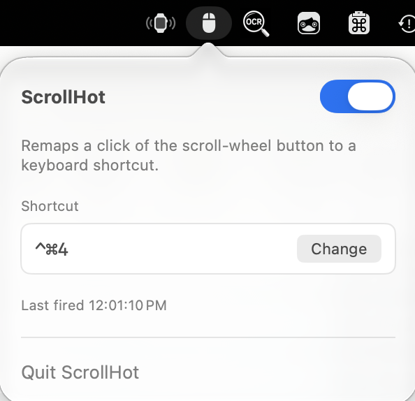

# ScrollHot

A tiny macOS menu-bar app that remaps a **click of the scroll-wheel button** (the middle button) to any keyboard shortcut you choose.

Press the scroll wheel in → ScrollHot fires the shortcut you assigned. That's the whole app.



> ScrollHot is the version 2 rebuild of **MouseyHot**. The original tried to remap several mouse buttons and gestures, which caused bugs on the Magic Mouse and trackpad. This rewrite does one thing only — the scroll-wheel click — which makes it small, predictable, and reliable.

---

## Why the rewrite

MouseyHot leaned on higher-level gesture and multi-button mapping. On devices without a real physical middle button (Magic Mouse, trackpad) those events are synthesized inconsistently, so remapping misfired or double-fired.

ScrollHot narrows the scope to a single, well-defined hardware event: `otherMouseDown` with `buttonNumber == 2`. That is the scroll-wheel press on a standard mouse. By tapping only that one event and consuming it, the behavior is deterministic and there's nothing to conflict with.

## Features

- Remap the scroll-wheel click to any modifier + key combination (or a function key).
- Lives in the menu bar only — no Dock icon, no window clutter (`LSUIElement`).
- Record a shortcut by clicking the field and pressing the keys.
- Toggle on/off from the menu-bar popover.
- Shows a "last fired" timestamp so you can confirm it's working.
- Remembers your shortcut and on/off state between launches.

## Requirements

- macOS 13.0 (Ventura) or later
- A mouse with a clickable scroll wheel (the middle button)
- Xcode 15+ to build from source

## Install

### Download

Grab `ScrollHot-1.0.zip` from the [latest release](https://github.com/technomaybe/ScrollHot/releases/latest), unzip it, and drag **ScrollHot.app** into `/Applications`. It runs on Apple silicon and Intel Macs.

ScrollHot isn't signed with an Apple Developer ID or notarized, so macOS will block it the first time. Try to launch it once, then go to System Settings → Privacy & Security and click **Open Anyway**.

### Build from source

```bash
git clone https://github.com/technomaybe/ScrollHot.git
cd ScrollHot
open ScrollHot.xcodeproj
```

In Xcode, select the **ScrollHot** scheme and press **⌘R** to build and run. To keep the app around, use **Product → Archive** (or drag the built `.app` from the Products group into `/Applications`).

## First-run permission

ScrollHot uses a `CGEventTap` to see and remap mouse clicks, which requires **Accessibility** permission. On first launch macOS will prompt you; if it doesn't, grant it manually:

**System Settings → Privacy & Security → Accessibility → enable ScrollHot.**

The popover shows an orange warning until permission is granted. Once trusted, the event tap starts automatically.

> ScrollHot runs **without** the App Sandbox on purpose — a sandboxed app cannot install a system-wide event tap. See `ScrollHot/ScrollHot.entitlements`.

## Usage

1. Click the mouse icon in the menu bar to open the popover.
2. Click the **Shortcut** field and press the keys you want (e.g. `⌘⇧4`). Press `Esc` to cancel, `Delete` to clear.
3. Make sure the toggle at the top is on.
4. Press your scroll-wheel button — ScrollHot fires the shortcut and the original middle-click action is suppressed.

## How it works

| Piece | Role |
| --- | --- |
| `EventMonitorService` | Installs a `CGEventTap` on `.otherMouseDown`, filters for button 2, and consumes the event. Re-enables itself if macOS disables the tap. |
| `HotKeyEmitter` | Posts synthetic key-down / key-up events for the assigned shortcut. |
| `HotKey` | Codable model of a key code + modifier flags, with a display string (`⌘⇧4`). |
| `SettingsStore` | Persists the shortcut and enabled state via `UserDefaults`. |
| `StatusBarController` | Owns the menu-bar item and the popover. |
| `ContentView` / `HotKeyRecorderView` | SwiftUI popover UI and the AppKit key-recorder field. |

## Project layout

```
ScrollHot/
├── ScrollHotApp.swift          # App entry point (menu-bar accessory)
├── AppDelegate.swift           # Launch + Accessibility permission flow
├── Models/
│   └── HotKey.swift
├── Services/
│   ├── EventMonitorService.swift
│   ├── HotKeyEmitter.swift
│   └── SettingsStore.swift
└── Views/
    ├── StatusBarController.swift
    ├── ContentView.swift
    └── HotKeyRecorderView.swift
```

## License

[MIT](LICENSE) © 2026 Patrick Schroeder
